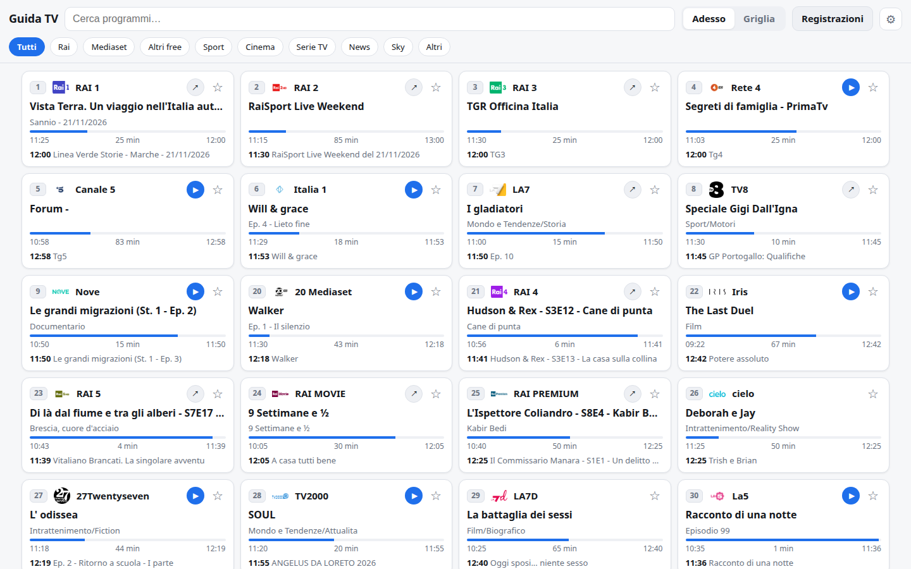
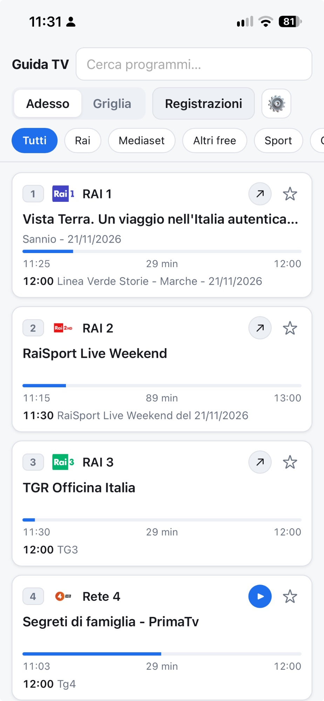
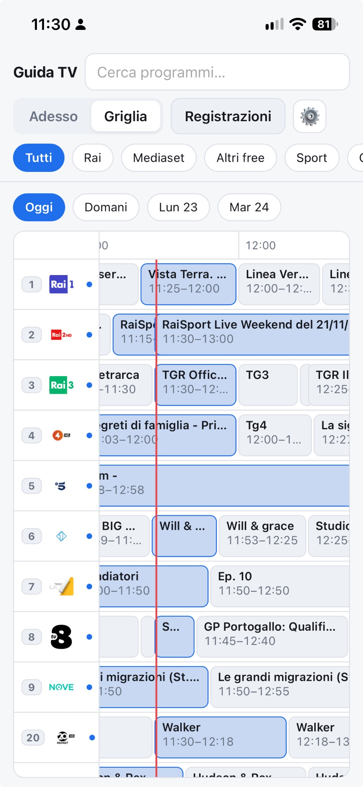

# Guida TV

Guida TV dei canali italiani, in locale. Raggiungibile da LAN e Tailscale.

[English overview](#english-overview)

- **epg**: basato su `ghcr.io/iptv-org/epg` — scarica i palinsesti (Rai, Mediaset, Sky, Superguida) e genera `guide.xml` (XMLTV). Aggiornamento all'avvio e alle 04:00 e 14:00.
- **web**: Node (senza framework) — legge l'XMLTV, lo tiene in memoria, espone `/api/*` e serve la SPA (vanilla JS, nessuna build). Conserva l'ultima guida valida in un volume.

## Schermate

### Desktop


<details>
<summary>Vista Adesso e scheda del programma</summary>




</details>

### iPhone

<p>
  <a href="docs/screenshots/iphone-now.jpg"></a>
  <a href="docs/screenshots/iphone-grid.jpg"></a>
  <a href="docs/screenshots/iphone-programme.jpg"></a>
</p>

## Uso
```
test -e .env || cp .env.example .env
docker compose up -d --build
```

Apri `http://127.0.0.1:8085`. La guida parte senza NAS. Per LAN o Tailscale, imposta `GUIDATV_BIND=` su una rete fidata per ascoltare su tutte le interfacce, oppure indica l'indirizzo IP di una singola interfaccia. Usa `GUIDATV_PORT` per cambiare porta. Per l'accesso fuori casa usa Tailscale, perché GuidaTV non richiede un login.

Configura i valori locali in `.env`, escluso da Git. `GUIDATV_STREAMS_M3U` permette di usare una playlist HTTP(S) o un file nel container, per esempio `/streams/local.m3u` dalla cartella `streams/`. Il file `streams/local.m3u` è escluso da Git.

Su telefono: "Aggiungi a schermata Home" per averla come app.

## Canali
`epg/channels.xml` è generato da `node epg/build-channels.mjs` (unisce le sorgenti iptv-org senza doppioni;
priorità Rai > Mediaset > Sky > Superguida). Modifica lo script (EXCLUDE/ALIAS) e rigenera, poi `docker compose restart epg`.
I canali senza dati non compaiono nell'app.

L'app usa i loghi dei canali presenti in `guide.xml` e, se mancano, gli URL in `server/src/logos.json` (iptv-org, Sky, Tivùsat, SuperGuida TV e RaiPlay).

In **Cinema**, **Serie TV** e **News** la guida mostra i programmi corrispondenti di tutti i canali. **Adesso** mostra quelli in onda, **Griglia** quelli del giorno selezionato. La copertura dipende dai metadati delle emittenti e dai titoli riconoscibili dei telegiornali.

Usa **Aggiorna guida** in **Impostazioni** o **Registrazioni** per riscaricare i palinsesti. L’operazione può richiedere qualche minuto. Se l’EPG pubblica un nuovo orario per una registrazione, GuidaTV propone **Aggiorna prenotazione**.

Per una prenotazione importante, attiva **Ricontrolla guida** in **Registrazioni**. GuidaTV chiede un aggiornamento quando mancano tra 90 e 15 minuti all’inizio della cattura. Nella prenotazione indica se il nuovo orario è coperto dai margini e segnala nel contatore un eventuale orario fuori dalla finestra di cattura. Puoi confermare la modifica con **Aggiorna prenotazione**.

`epg/superguidatv.it.config.js` sostituisce lo scraper upstream, rotto dopo la riscrittura del sito.

## Numero di canale (LCN) e visione in diretta
- Il numero del digitale terrestre compare accanto al canale e determina l'ordine. Predefiniti in `server/src/lcn.json`
  (numeri nazionali: possono differire per regione); per correggerli metti un `lcn.json` nel volume dati (`/data/lcn.json`, stesse chiavi).
- Il pulsante ▶ compare solo per i canali con uno stream. Gli stream si danno al server con una playlist M3U
  (`/data/streams.m3u`, oppure `STREAMS_M3U=<url o file>` nel compose; ricaricata ogni ~6 h). Le voci sono associate ai canali
  per `tvg-id`/nome; a parità vince la prima. Il compose usa `streams/official.m3u`: solo stream ufficiali in chiaro
  (Mediaset, TV2000, Warner Bros. Discovery). Per Rai, La7 e TV8, il pulsante della diretta apre il sito o l'app ufficiale.
  Le voci con `mux="1"` (Mediaset: audio e video su tracce HLS separate, che VLC desincronizza) passano da `ffmpeg -c copy`
  nel container (`/api/live/<id>.ts`, max `MAX_MUX`=4 contemporanei). Mediaset è geo-limitato all'Italia.
- Il player è per-dispositivo (⚙ in alto): **.m3u** (il browser scarica un file che il sistema apre con VLC, funziona ovunque),
  **schema URL** (`vlc://{url}`, utile su iOS/Android) o **copia indirizzo**.

## Registrazioni

Dalla scheda di un programma su un canale con stream diretto, **Registra** apre la prenotazione con i margini personalizzabili. Se superi il limite simultaneo (2 per impostazione predefinita, configurabile da 1 a 8 con `RECORDINGS_MAX_CONCURRENT`), GuidaTV mostra quali prenotazioni si sovrappongono e chiede una conferma. Una prenotazione in attesa parte appena si libera un posto se il programma è ancora in onda.

**Registra la serie** prenota le prossime trasmissioni con lo stesso titolo sullo stesso canale agli aggiornamenti della guida. Usa **Salta puntata** per escludere una trasmissione oppure **Serie seguite** per fermare le nuove prenotazioni automatiche. Se la guida fornisce stagione ed episodio, GuidaTV li usa per riconoscere le repliche. Le nuove prenotazioni automatiche usano i margini predefiniti e rispettano il limite simultaneo durante la cattura.

**Aggiorna prenotazione** appare quando il palinsesto propone un nuovo orario con una corrispondenza univoca entro tre ore. I margini si possono rivedere prima della conferma. **Registra per orario** permette di scegliere direttamente un canale con stream registrabile, inizio e fine, anche quando il programma manca dalla guida. La durata massima è 24 ore.

Per abilitare le registrazioni sperimentali di TV8, imposta `RECORDINGS_TV8=1` nel file `.env` con un NAS configurato. GuidaTV richiede al player ufficiale un indirizzo valido all'avvio e a ogni riconnessione. Le interruzioni durante il programma possono lasciare dei salti nel video e una registrazione parziale. Il pulsante della diretta apre il sito ufficiale.

Con `RECORDINGS_RAI=1` puoi registrare Rai 1, Rai 2, Rai 3, Rai 4, Rai 5, Rai Movie, Rai Premium, Rai Gulp, Rai Yoyo, Rai Storia, Rai News 24, Rai Sport e Italiana. GuidaTV richiede al servizio di RaiPlay un nuovo indirizzo a ogni tentativo e rispetta la disponibilità geografica e gli eventuali oscuramenti del flusso. Il pulsante della diretta apre RaiPlay.

In **Registrazioni** puoi vedere l'orario di cattura previsto, annullare le prenotazioni future e usare **Ferma e salva** sulle registrazioni in corso per trasferire al NAS quanto già acquisito. Se fermi una cattura prima dell'orario di fine del programma indicato in guida, la registrazione è contrassegnata come parziale.

Il margine predefinito è di 2 minuti prima e 10 dopo. Per modificarlo, imposta `RECORDINGS_BEFORE_MIN` e `RECORDINGS_AFTER_MIN` nel file `.env` accanto a `docker-compose.yml` e applica la configurazione con `docker compose up -d --no-deps web`. I valori sono minuti interi da 0 a 60. Per aggiornare i margini di una prenotazione già in coda, usa **Modifica** in **Registrazioni**. GuidaTV mostra i nuovi orari di cattura e verifica le sovrapposizioni prima del salvataggio.

Il servizio cattura in MPEG-TS in `/data/recordings`. Al termine, salva audio e video in MP4 senza ricodificarli e trasferisce il file alla condivisione configurata in `GUIDATV_SMB_SHARE`. Se il trasferimento fallisce, il file resta in locale e il servizio riprova dopo un minuto. Nel frattempo può trasferire le altre registrazioni. La finestra mostra durata e dimensione quando disponibili, l'orario del prossimo ritentativo e un contatore dei nuovi esiti per browser.

Imposta `RECORDINGS_VSMETA=1` per salvare i metadati dei film nel formato di Synology Video Station. GuidaTV pubblica `nome.mp4.vsmeta` accanto all'MP4, prima di rendere visibile il video. Usa i dati disponibili in guida, compresa l'immagine JPEG quando scaricabile. Per l'importazione, la cartella di destinazione deve essere indicizzata come **Film** in Video Station. I metadati e i file aggiunti in precedenza sul NAS vengono conservati.

Le registrazioni salvate restano visibili finché il file è nella condivisione. GuidaTV verifica il NAS mentre la finestra è aperta. Una cancellazione o uno spostamento si riflette alla verifica successiva. La finestra mostra prima le registrazioni in corso, in attesa o programmate e permette di cercare per titolo o canale, con 10 risultati per pagina. Le registrazioni fallite restano visibili finché vengono rimosse dalla finestra.

Durante la cattura, **+15 min** e **+30 min** spostano l’orario di fine. GuidaTV chiede conferma se l’estensione supera il limite di registrazioni contemporanee. Puoi terminare prima con **Ferma e salva**.

**Riproduci** usa il player configurato in ⚙. Su Mac, la playlist M3U delle registrazioni apre per impostazione predefinita il file nella condivisione montata dal Finder sotto `/Volumes`. Monta la condivisione prima della riproduzione. In ⚙ puoi indicare un altro percorso del volume o scegliere **Indirizzo SMB** per tornare al collegamento diretto.

Il collegamento diretto usa l'host di `GUIDATV_SMB_SHARE` su LAN. Via Tailscale imposta `GUIDATV_SMB_TAILSCALE_HOST` all'indirizzo Tailscale o al nome MagicDNS del NAS. Il dispositivo che riproduce deve poter accedere alla condivisione SMB e VLC può chiedere le credenziali del NAS.

Per abilitare le registrazioni, imposta `GUIDATV_SMB_SHARE`, ad esempio `//nas.local/TV`. Se Docker non risolve il nome del NAS, imposta anche `GUIDATV_SMB_IP` al suo indirizzo LAN. Crea `~/.config/guidatv/smb.credentials` (permessi `600`) con le righe `username=nome_utente` e `password=…`. L'utente SMB deve poter leggere, creare e rinominare file nella condivisione. Usa `GUIDATV_SMB_DIR` per scegliere un'altra directory di credenziali.

In **Impostazioni → Verifica configurazione** trovi l’ultimo caricamento della guida, i canali registrabili e lo spazio locale. **Prova scrittura sul NAS** crea, rinomina, verifica e rimuove un piccolo file temporaneo.

### Player nel browser

Per attivare **Nel browser** per i file MP4, imposta `RECORDINGS_BROWSER=1` e crea un file `browser.password` accanto a `smb.credentials`, leggibile dal container, con la password su una sola riga. Con la configurazione standard, `(umask 077 && openssl rand -hex 24 > ~/.config/guidatv/browser.password)` genera una password casuale. Riavvia il servizio web e usa quella password nella finestra del player. Per l'accesso fuori casa usa un indirizzo HTTPS o la tua rete Tailscale. GuidaTV legge i segmenti richiesti dal NAS per permettere la ricerca nel video. La compatibilità audio e video dipende dai codec supportati dal browser.

## Sviluppo
`cd server && npm install && npm test`

## English overview

Guida TV is a self-hosted TV guide built for Italian television. It fetches Italian programme listings, offers a live schedule grid and search, and can record supported channels to an SMB NAS. The interface is in Italian.

To adapt it for another country, supply an XMLTV guide, local channel mappings and compatible streams in an M3U playlist. The bundled channels and recording integrations are specific to Italian broadcasters. Live streams may be subject to regional availability and programme restrictions.

[Installation and configuration (Italian)](#uso)
