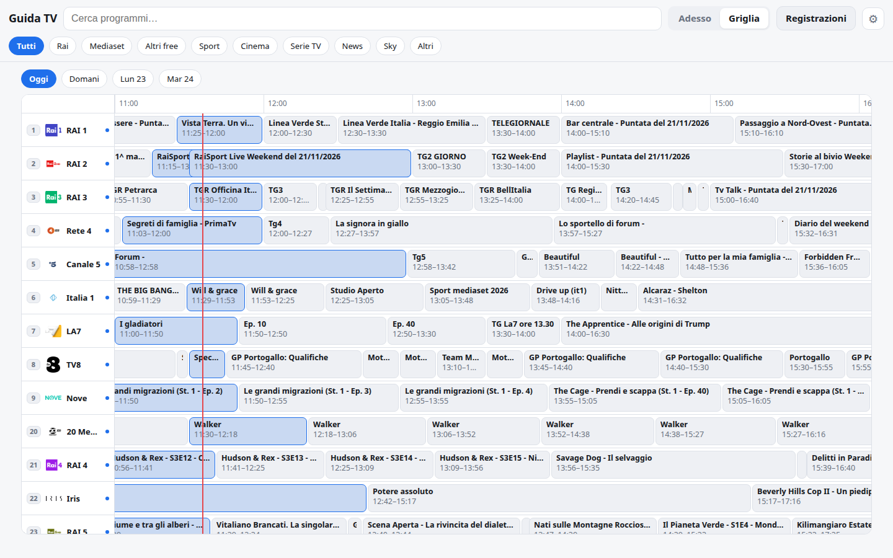
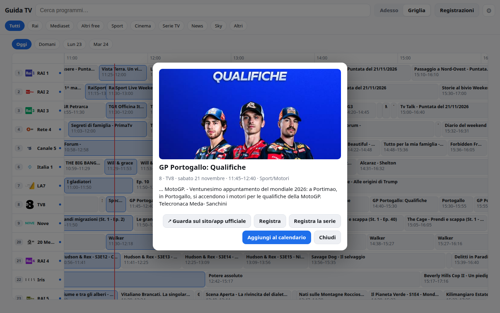

# Guida TV

Le app che mostrano la guida TV non mancano, iPhone compreso. Alcune permettono di aprire le app ufficiali delle emittenti per guardare un programma in streaming. Nessuna, che io sappia, permette di registrarlo. Così ho costruito GuidaTV, una guida TV dei canali italiani che gira a casa mia e salva le registrazioni sul NAS. In pratica, un PVR (personal video recorder) fatto in casa.

Puoi accedere a GuidaTV dalla rete locale o tramite Tailscale.

[Installazione Docker](#installazione-rapida-con-docker) · [Configurazione NAS](#abilitare-le-registrazioni-sul-nas) · [Uso della guida](#usare-la-guida) · [Registrazioni](#registrazioni) · [Schermate](#schermate) · [English overview](#english-overview)

[](https://www.buymeacoffee.com/trapias)

## Installazione rapida con Docker

**La guida si avvia con Docker Compose.** Con Git e Docker già installati, esegui questi comandi. Il NAS serve solo se vuoi registrare.

```sh
git clone https://github.com/trapias/GuidaTV.git
cd GuidaTV
test -e .env || cp .env.example .env
docker compose up -d --build
```

Apri **[http://127.0.0.1:8085](http://127.0.0.1:8085)** sul computer che esegue Docker. Al primo avvio, attendi qualche minuto mentre vengono scaricati i palinsesti.

Per aprire la guida **da un altro dispositivo**, imposta `GUIDATV_BIND=` nel file `.env` per ascoltare su tutte le interfacce, oppure specifica l’indirizzo di una singola interfaccia. Applica la modifica con `docker compose up -d --no-deps web` e apri `http://IP_DEL_SERVER:8085`. Puoi cambiare porta con `GUIDATV_PORT`. Su iPhone puoi usare **Aggiungi alla schermata Home**.

GuidaTV non richiede un login, quindi limita l’accesso a una rete fidata e usa Tailscale fuori casa. [Guida rapida di Tailscale](https://tailscale.com/docs/how-to/quickstart)

Per aggiornare un’installazione esistente, dalla cartella del progetto esegui `git pull` e poi `docker compose up -d --build`. Il file `.env` e il volume dati restano disponibili.

### Abilitare le registrazioni sul NAS

1. Nel file `.env` imposta `GUIDATV_SMB_SHARE=//nas.local/TV` con l’indirizzo della tua condivisione SMB.
2. Crea la cartella con `mkdir -p ~/.config/guidatv`. Salva queste due righe in `~/.config/guidatv/smb.credentials`, usando le credenziali del NAS.

   ```ini
   username=nome_utente
   password=la_tua_password
   ```

   Proteggi il file con `chmod 600 ~/.config/guidatv/smb.credentials` e assicurati che l’utente del container possa leggerlo. L’account SMB deve poter leggere, creare, rinominare ed eliminare file nella condivisione.
3. Applica la configurazione con `docker compose up -d --no-deps web`. Apri **Impostazioni → Verifica configurazione → Prova scrittura sul NAS**. La pagina indica anche quali canali puoi registrare, lo spazio locale disponibile e lo stato del palinsesto e del player web.
4. Apri la scheda di un programma su un canale registrabile e premi **Registra**.

Se Docker non risolve il nome del NAS, imposta `GUIDATV_SMB_IP` al suo IP sulla rete locale. Puoi indicare una cartella diversa per le credenziali con `GUIDATV_SMB_DIR`.

## Usare la guida

### Adesso, Griglia e canali visibili

**Adesso** mostra i programmi in onda. **Griglia** mostra il palinsesto del giorno selezionato. I filtri **Cinema**, **Serie TV** e **News** trovano i programmi del tipo scelto sui canali visibili, in base ai metadati disponibili.

Apri **Canali** e scegli cosa mostrare in entrambe le viste. Puoi togliere la spunta a un’intera emittente, ad esempio **Sky**, o cercare e selezionare un singolo canale. **Nascondi canali senza LCN** deseleziona in blocco quelli a cui la guida non assegna un numero del digitale terrestre. Puoi riattivarli uno per uno. Premi **Salva** per applicare la scelta in questo browser.

### Visione in diretta

La playlist inclusa contiene stream ufficiali in chiaro di Mediaset, TV2000 e Warner Bros. Discovery. Per Rai, La7 e TV8, il pulsante della diretta apre l’app o il sito ufficiale. I flussi Mediaset sono limitati all’Italia.

In **Impostazioni** scegli come aprire gli stream diretti su questo dispositivo. Puoi scaricare una playlist **.m3u** da aprire con VLC, usare uno **schema URL** come `vlc://{url}` o **copiare l’indirizzo**.

### Aggiornare i palinsesti

I palinsesti si aggiornano all’avvio e alle 04:00 e 14:00, ora italiana. Puoi usare **Aggiorna guida** in **Impostazioni** o **Registrazioni**. La barra di avanzamento mostra quante richieste di palinsesto sono state elaborate.

### Eventi Prime Video

**Adesso** mostra le dirette di Prime Video o il prossimo evento. **Griglia** mostra gli eventi del giorno selezionato in una riga Prime Video. Entrambe le viste li includono in **Tutti** e **Sport**. Seleziona il filtro **Prime Video** accanto a **Tutti** per consultare l’intero calendario degli eventi inclusi con Prime pubblicati nella pagina Sport italiana.

Su iPhone e iPad, **Apri nell’app** usa il collegamento di Prime Video all’evento. **Apri sul web** porta alla pagina ufficiale. L’accesso con il tuo account Amazon avviene su Prime Video. Per gli eventi futuri, **Aggiungi al calendario** scarica un file `.ics` con l’orario d’inizio e un promemoria cinque minuti prima.

Per nascondere gli eventi e il relativo filtro, apri **Canali**, togli la spunta **Prime Video** in alto e premi **Salva**. La scelta si applica ad **Adesso** e **Griglia** per quel browser.

## Registrazioni

### Prenotare un programma, una serie o un orario

- **Registra** dalla scheda del programma per scegliere i margini prima e dopo la trasmissione. Per cambiare una prenotazione in coda usa **Modifica**.
- **Registra la serie** per prenotare le prossime trasmissioni con lo stesso titolo sullo stesso canale agli aggiornamenti della guida. Se sono disponibili stagione ed episodio, GuidaTV li usa per riconoscere le repliche. Puoi scegliere **Salta puntata** o fermare le nuove prenotazioni da **Serie seguite**.
- **Registra per orario** da **Registrazioni** per scegliere canale, inizio e fine direttamente. La durata massima è 24 ore.

In **Impostazioni → Profili margini** puoi salvare nel browser i tuoi margini per **Film** e **Sport in diretta**. I valori predefiniti del server sono 2 minuti prima e 10 dopo, anche per le prenotazioni automatiche delle serie. Puoi cambiarli in `.env` con `RECORDINGS_BEFORE_MIN` e `RECORDINGS_AFTER_MIN` (da 0 a 60 minuti).

Il limite predefinito è di 2 catture simultanee. Puoi impostarlo da 1 a 8 con `RECORDINGS_MAX_CONCURRENT`. Quando una prenotazione o un’estensione supererebbe il limite, GuidaTV mostra le sovrapposizioni e chiede conferma. Se una cattura è in attesa, parte quando si libera un posto e il programma è ancora in onda. Applica le modifiche a `.env` con `docker compose up -d --no-deps web`.

### Gestire la coda e i cambi di orario

In **Registrazioni** puoi cercare per titolo o canale anche oltre le prime dieci voci di ogni sezione. Le sezioni **In corso**, **Programmate** e **Salvate** si possono richiudere. Le registrazioni fallite restano in **Da verificare** finché le rimuovi.

- **Aggiorna prenotazione** appare se il nuovo palinsesto propone un orario con una corrispondenza univoca entro tre ore. Puoi rivedere i margini prima di confermare.
- **Ricontrolla guida**, in **Altre azioni**, chiede un aggiornamento della guida tra 90 e 15 minuti prima della cattura. La prenotazione mostra se il nuovo orario è coperto dai margini e il contatore segnala gli orari che escono dalla finestra di cattura.
- **Annulla**, in **Altre azioni**, rimuove una prenotazione futura.
- **Altre azioni → +15 min** o **+30 min** estende una cattura in corso. **Ferma e salva** trasferisce al NAS quanto già acquisito. Se interrompi la cattura prima della fine del programma, la registrazione è contrassegnata come parziale.

### Salvare gli MP4 e archiviare i film

GuidaTV cattura in MPEG-TS nel volume locale e trasferisce al NAS un MP4. Audio e video vengono copiati senza ricodifica. Se la copia dell’audio AAC fallisce per un errore del filtro ADTS, GuidaTV ricodifica l’audio e conserva il video originale. Se il trasferimento fallisce, il file resta in locale e viene ritentato dopo un minuto. In **Registrazioni** trovi il prossimo tentativo, durata e dimensione quando disponibili e un contatore dei nuovi esiti per browser. L’elenco **Salvate** si riallinea mentre è aperto se sposti o elimini un file dal NAS.

Per salvare i film in una cartella separata sullo stesso NAS, imposta `GUIDATV_SMB_MOVIE_SHARE` nel file `.env`, ad esempio `//nas.local/Video/Film registrati`. La scelta vale per i nuovi trasferimenti. Per i film riconosciuti GuidaTV usa il titolo nel nome del file e aggiunge l’anno, se disponibile.

- **The Movie Database**. Le schede dei film, in guida e tra le registrazioni, mostrano il link quando GuidaTV trova lo stesso titolo. Se la guida indica l’anno di uscita, la ricerca ammette un anno di differenza. La ricerca pubblica funziona senza configurazione e i risultati vengono salvati nel volume dati. Per usare l’API ufficiale, accedi al tuo account TMDB, richiedi una chiave e imposta `TMDB_API_KEY` nel file `.env` con la chiave API o il token di lettura. [Impostazioni API di TMDB](https://www.themoviedb.org/settings/api)
- **Synology Video Station**. Imposta `RECORDINGS_VSMETA=1` per salvare un file `.mp4.vsmeta` accanto al film con i metadati della guida e, quando scaricabile, la copertina JPEG. Indicizza la cartella di destinazione come **Film** in Video Station.

### Riprodurre con VLC o nel browser

**Riproduci** usa il player configurato in **Impostazioni**. Su Mac, la playlist M3U usa per impostazione predefinita il volume SMB montato nel Finder sotto `/Volumes`. Puoi indicare un percorso diverso o scegliere **Indirizzo SMB** per aprire il collegamento diretto. Via Tailscale imposta `GUIDATV_SMB_TAILSCALE_HOST` con l’indirizzo Tailscale o il nome MagicDNS del NAS. Il dispositivo deve poter accedere a SMB e VLC può chiedere le credenziali.

Per abilitare **Nel browser**, imposta `RECORDINGS_BROWSER=1` in `.env`. Crea `browser.password` accanto a `smb.credentials` con la password su una sola riga, leggibile dal container. Puoi generarne una con `(umask 077 && openssl rand -hex 24 > ~/.config/guidatv/browser.password)`. Applica con `docker compose up -d --no-deps web` e usa la password nella finestra del player. Per accedere da fuori casa usa HTTPS o la tua rete Tailscale.

Il player web legge l’MP4 dal NAS e salva il punto di visione nel browser. Puoi scegliere **Riprendi** o **Vai all’inizio previsto** per saltare il margine di registrazione. La compatibilità audio e video dipende dai codec supportati dal browser.

### Registrare da RaiPlay e TV8

Con un NAS configurato, imposta `RECORDINGS_RAI=1` o `RECORDINGS_TV8=1` per abilitare le sorgenti sperimentali dei player ufficiali. Per RaiPlay sono supportati Rai 1, Rai 2, Rai 3, Rai 4, Rai 5, Rai Movie, Rai Premium, Rai Gulp, Rai Yoyo, Rai Storia, Rai News 24, Rai Sport e Italiana. Valgono i limiti geografici e gli oscuramenti del flusso. GuidaTV richiede un nuovo indirizzo al player ufficiale a ogni tentativo. Le interruzioni possono lasciare salti nel video o produrre una registrazione parziale.

## Schermate

### Desktop



<details>
<summary>Vista Adesso e scheda del programma</summary>




</details>

### iPhone

<p>
  <a href="docs/screenshots/iphone-now.jpg"></a>
  <a href="docs/screenshots/iphone-grid.jpg"></a>
  <a href="docs/screenshots/iphone-programme.jpg"></a>
</p>

## Configurazione avanzata

### Numerazione e playlist

Il numero LCN del digitale terrestre, se disponibile, determina l’ordine dei canali. Per personalizzare la numerazione, aggiungi un file `lcn.json` nel volume dati (`/data/lcn.json`) con le chiavi di [server/src/lcn.json](server/src/lcn.json).

Per usare una playlist personalizzata, imposta `GUIDATV_STREAMS_M3U` nel file `.env` con un URL HTTP(S) o un percorso nel container, ad esempio `/streams/local.m3u` per il file `streams/local.m3u` escluso da Git. GuidaTV rilegge la playlist circa ogni sei ore e associa i flussi per `tvg-id` o nome, dando precedenza alla prima corrispondenza. Con `mux="1"`, FFmpeg unisce audio e video HLS in un flusso compatibile con VLC senza ricodifica (`/api/live/<id>.ts`, limite `MAX_MUX` predefinito di 4).

### Sorgenti dei palinsesti e sviluppo

- **epg** usa iptv-org per generare `guide.xml`. Per cambiare il catalogo condiviso, modifica `EXCLUDE` o `ALIAS` in [epg/build-channels.mjs](epg/build-channels.mjs), esegui `node epg/build-channels.mjs` e riavvia il servizio con `docker compose restart epg`. Lo script unisce le sorgenti senza duplicati, dando precedenza a Rai, Mediaset, Sky e Superguida in quest’ordine. Il progetto include uno scraper aggiornato per SuperGuida TV.
- **web** serve l’interfaccia in JavaScript e le API con Node. Conserva in un volume l’ultima guida valida. Mostra i canali con dati disponibili e usa i loghi XMLTV, con [server/src/logos.json](server/src/logos.json) come riserva.

Per eseguire i test del server, usa `cd server && npm install && npm test`.

## English overview

GuidaTV is a self-hosted TV guide and PVR for Italian television. Browse what’s on, search the programme grid, and choose which channels to show. Live and upcoming Prime Video sports events link to the official service and support calendar reminders for upcoming events. With an SMB NAS, you can schedule single TV programmes or series, save them as MP4s, and optionally play them in the browser.

Docker Compose starts the guide without a NAS. The interface is in Italian, and the bundled channels and recording sources are specific to Italian broadcasters.

[Quick start with Docker](#installazione-rapida-con-docker) · [SMB NAS setup](#abilitare-le-registrazioni-sul-nas)
